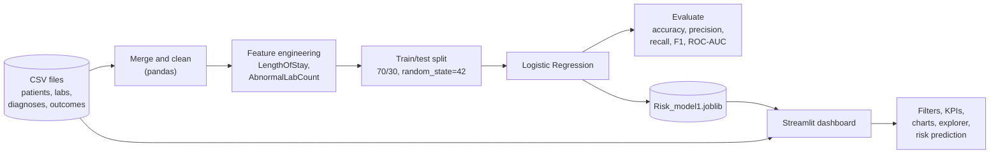
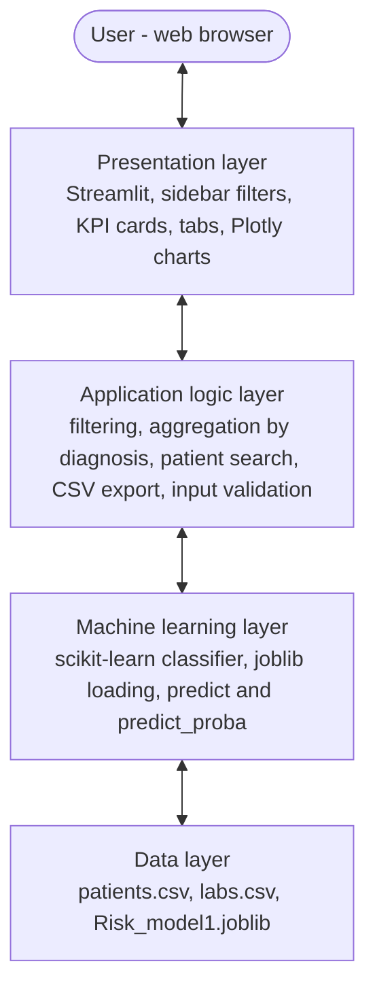
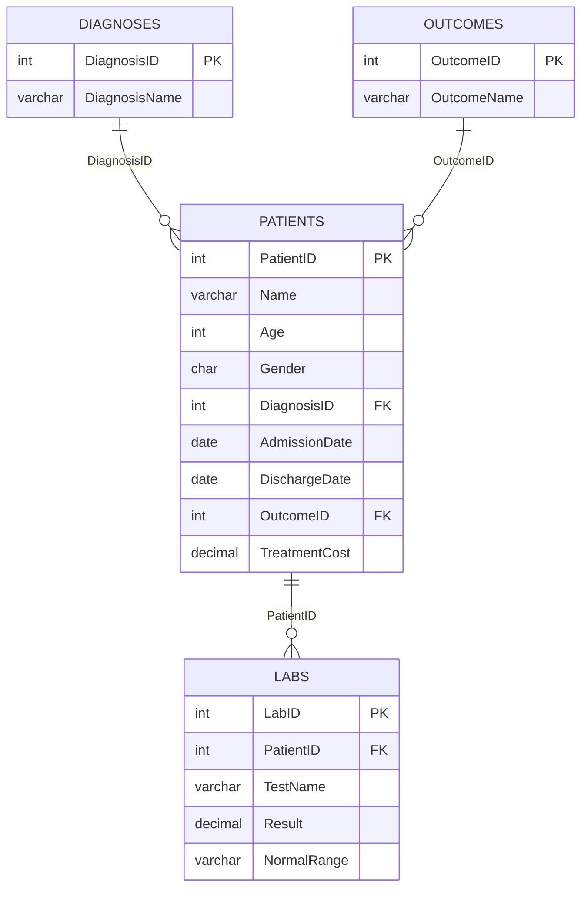

<div align="center">

# 🏥 Healthcare Risk Stratification Using Machine Learning

**Hospital records analysis, SQL analytics, adverse-outcome prediction and an interactive Streamlit dashboard**


</div>

> ⚠️ **Educational project.** The dataset is synthetic and the model is a small prototype. Nothing here is a clinical diagnosis tool or a validated medical risk assessment.

---

## 📑 Table of Contents

1. [Project Title and Introduction](#1-project-title-and-introduction)
2. [Project Overview](#2-project-overview)
3. [Problem Statement](#3-problem-statement)
4. [Project Objectives](#4-project-objectives)
5. [Key Features](#5-key-features)
6. [Technologies and Tools Used](#6-technologies-and-tools-used)
7. [Project Architecture / Workflow](#7-project-architecture--workflow)
8. [Dataset Description](#8-dataset-description)
9. [Data Preprocessing and Cleaning](#9-data-preprocessing-and-cleaning)
10. [Exploratory Data Analysis (EDA)](#10-exploratory-data-analysis-eda)
11. [SQL Implementation and Important Queries](#11-sql-implementation-and-important-queries)
12. [Machine Learning Methodology](#12-machine-learning-methodology)
13. [Algorithms Used and Their Purpose](#13-algorithms-used-and-their-purpose)
14. [Model Training and Testing](#14-model-training-and-testing)
15. [Model Evaluation Metrics and Actual Results](#15-model-evaluation-metrics-and-actual-results)
16. [Healthcare Risk Stratification Methodology](#16-healthcare-risk-stratification-methodology)
17. [Project Folder Structure](#17-project-folder-structure)
18. [Installation and Setup Requirements](#18-installation-and-setup-requirements)
19. [Run the Project Locally (VS Code + PowerShell)](#19-step-by-step-run-the-project-locally-using-vs-code)
20. [Python Dependencies and requirements.txt](#20-python-dependencies-and-requirementstxt)
21. [How to Use the Project](#21-how-to-use-the-project)
22. [Results and Observations](#22-results-and-observations)
23. [Limitations and Future Enhancements](#23-limitations-and-future-enhancements)
24. [Learning Outcomes](#24-learning-outcomes)
25. [Author / Developer Information](#25-author--developer-information)
26. [License](#26-license)

---

## 1. Project Title and Introduction

**Healthcare Risk Stratification Using Machine Learning** brings scattered hospital records (patients, diagnoses, outcomes, lab results) into one analysis pipeline. It combines:

- **SQL** analytics on a relational schema,
- **pandas** data preparation and **scikit-learn** modelling, and
- a **Streamlit + Plotly** dashboard with filters, KPIs, a patient explorer and a single-patient prediction page.

The project was developed as a Minor Project for MCA Semester III at Jagan Institute of Management Studies, Delhi (per the project report). The report's own title is *"Healthcare Risk Analytics: Hospital Records Analysis and Patient Risk Prediction."*

## 2. Project Overview

| Item | Detail |
|---|---|
| Data | 200 synthetic patients, 604 lab results, 10 diagnoses, 3 outcome classes |
| Database layer | MySQL-dialect schema + 7 analytical queries ([`sql/healthcare_query.sql`](sql/healthcare_query.sql)) |
| ML task | Binary classification: **adverse outcome** (Complicated or Deceased = 1) vs **Recovered** (= 0) |
| Model | Logistic Regression (scikit-learn), 4 input features |
| Front end | Streamlit dashboard ([`Healthcare_Risk_Dashboard.py`](Healthcare_Risk_Dashboard.py)) and a minimal predictor ([`Risk_Model.py`](Risk_Model.py)) |
| Model notebook | [`Risk_model1.ipynb`](Risk_model1.ipynb) |

## 3. Problem Statement

Hospital data is typically split across separate tables or sheets, risk is judged manually from experience, summaries such as cost per diagnosis are prepared by hand, and there is no quick way to estimate the risk of a new patient from a few values. This project combines the records into one interactive view and adds a machine-learning estimate of adverse-outcome probability.

## 4. Project Objectives

1. Clean and combine patient, diagnosis, outcome and lab data for analysis.
2. Build a machine-learning model that estimates the likelihood of an adverse outcome.
3. Build an interactive dashboard with filters, KPI cards and charts.
4. Analyse treatment cost, length of stay and outcomes by diagnosis.
5. Provide a page where a user enters patient details and receives a prediction with a probability.
6. Evaluate the model with standard classification metrics.

## 5. Key Features

- 🔎 **Sidebar filters**: diagnosis, outcome, gender, risk level and an age-range slider; every KPI, chart and table updates together.
- 📊 **5 KPI cards**: patients, high-risk patients, average age, total treatment cost (₹), recovered patients.
- 📈 **Overview charts**: risk-level donut, outcome bar, cost by diagnosis, age histogram by risk level, length-of-stay vs cost scatter.
- 🩺 **Diagnosis & Labs tab**: patients, average cost and average stay per diagnosis; histogram + box plot for any lab test.
- 👥 **Patient Explorer**: case-insensitive search by name or ID, with CSV download of the filtered rows.
- 🤖 **Predict Risk tab**: four inputs → predicted class, estimated adverse-outcome probability and a gauge chart.
- 📂 **Optional CSV upload** in the sidebar (patients and labs) to replace the default files.
- 🗄️ **SQL script** with schema and 7 analytical queries.
- 🎨 Custom dark-blue Streamlit theme ([`.streamlit/config.toml`](.streamlit/config.toml)).

## 6. Technologies and Tools Used

| Category | Tools |
|---|---|
| Language | Python 3 |
| Data processing | pandas, NumPy |
| Machine learning | scikit-learn (`LogisticRegression`, `train_test_split`, metrics), joblib |
| Visualisation | Plotly (Express + Graph Objects), Matplotlib (ROC curve in notebook) |
| Web app | Streamlit with custom CSS |
| Database | SQL (MySQL syntax: `create database`, `use`) |
| Environment | VS Code, Jupyter Notebook, Git/GitHub, Windows |

## 7. Project Architecture / Workflow

### End-to-end workflow



### Four-layer application architecture (as described in the project report)



## 8. Dataset Description

> The report states the data is a **synthetic dataset generated with ChatGPT**. All names are fictitious, so no real patient data is included.

All figures below were computed directly from the CSV files in this repository.

| File | Rows | Description |
|---|---|---|
| [`patients.csv`](patients.csv) | 200 | One row per patient |
| [`labs.csv`](labs.csv) | 604 | One row per lab result (2–4 tests per patient) |
| [`diagnoses.csv`](diagnoses.csv) | 10 | Diagnosis lookup (`DiagnosisID`, `DiagnosisName`) |
| [`outcomes.csv`](outcomes.csv) | 3 | Outcome lookup: 1 Recovered, 2 Complicated, 3 Deceased |

**`patients.csv` columns:** `PatientID, Name, Age, Gender, DiagnosisID, AdmissionDate, DischargeDate, OutcomeID, TreatmentCost, DiagnosisName, OutcomeName, Length of stay, Abnormal Blood Sugar Flag, Risk Score`

**`labs.csv` columns:** `LabID, PatientID, TestName, Result, NormalRange`

| Characteristic | Value |
|---|---|
| Age | 18 – 90 years (mean 60.3) |
| Gender | M 103, F 97 |
| Length of stay | 1 – 92 days (mean 11.1) |
| Treatment cost | ₹2,000 – ₹10,000; total ₹999,868 |
| Outcomes | Recovered 134 (67%), Complicated 56 (28%), Deceased 10 (5%) |
| Diagnoses | Diabetes 32, Hypertension 29, Asthma 27, Arthritis 19, COPD 18, Kidney Disease 18, Liver Disease 17, Cancer 16, Heart Disease 16, Stroke 8 |
| Lab tests | Blood Pressure, Vitamin D, Hemoglobin, Creatinine, Blood Sugar, Cholesterol |
| Missing values | None in `patients.csv` |

**Entity relationships**



**Observations to be aware of:** 16 patients have a treatment cost of exactly ₹2,000 and 9 exactly ₹10,000 (an apparent floor/cap whose origin is not documented). The `Abnormal Blood Sugar Flag` column (High 34 / Normal 61 / No Data 105) is not used by the model and its derivation is not documented; 13 of the 34 "High" flags have a blood-sugar lab value ≤ 120.

## 9. Data Preprocessing and Cleaning

**In the notebook ([`Risk_model1.ipynb`](Risk_model1.ipynb)):**

1. Load `patients`, `diagnoses`, `outcomes`, `labs`.
2. Merge patients with diagnoses (`DiagnosisID`) and outcomes (`OutcomeID`).
3. Parse `AdmissionDate` and `DischargeDate` to datetime and compute `LengthOfStay = DischargeDate − AdmissionDate` (days).
4. Encode the target: `Recovered → 0`, `Complicated → 1`, `Deceased → 1`.
5. Compute `AbnormalLabCount` per patient from `labs.csv` (see [Section 12](#12-machine-learning-methodology)).

**In the dashboard ([`Healthcare_Risk_Dashboard.py`](Healthcare_Risk_Dashboard.py)):**

- `standardize_columns` strips whitespace from column names and maps `Length of stay → LengthOfStay`.
- Missing required columns are created with defaults (`"Unknown"` for text, `0` for numbers) and a warning is shown.
- `Age`, `TreatmentCost`, `LengthOfStay` are coerced with `pd.to_numeric(errors="coerce")`.
- Missing text values become `"Unknown"`.
- Uploaded CSVs are read as UTF-8 with a Latin-1 fallback.

## 10. Exploratory Data Analysis (EDA)

EDA is performed interactively in the dashboard. Computed facts from the shipped data:

| Diagnosis | Patients | Total cost (₹) | Avg cost (₹) | Avg stay (days) |
|---|---:|---:|---:|---:|
| Diabetes | 32 | 151,734 | 4,742 | 10.2 |
| Cancer | 16 | 125,958 | 7,872 | 16.9 |
| Liver Disease | 17 | 120,683 | 7,099 | 12.8 |
| COPD | 18 | 110,118 | 6,118 | 12.4 |
| Hypertension | 29 | 104,622 | 3,608 | 10.2 |
| Kidney Disease | 18 | 102,050 | 5,669 | 15.9 |
| Heart Disease | 16 | 91,017 | 5,689 | 13.7 |
| Asthma | 27 | 81,456 | 3,017 | 4.8 |
| Stroke | 8 | 60,572 | 7,572 | 13.9 |
| Arthritis | 19 | 51,658 | 2,719 | 7.8 |

- Diabetes has the highest **total** cost (largest patient count); Cancer has the highest **average** cost and longest average stay.
- Highest adverse-outcome shares: Stroke (6 of 8), Liver Disease (11 of 17) and Cancer (10 of 16); Diabetes has the most cases in absolute terms among the large groups (9 of 32).
- Of the 200 patients, 110 (55%) are labelled *High Risk* (see [Section 16](#16-healthcare-risk-stratification-methodology)).

| | |
|---|---|
|  |  |
|  |  |
|  |  |

## 11. SQL Implementation and Important Queries

Script: [`sql/healthcare_query.sql`](sql/healthcare_query.sql) (MySQL syntax).

**Schema:** `Diagnoses`, `Outcomes`, `Patients` (FKs to both) and `Labs` (FK to `Patients`), matching the ER diagram above.

| # | Purpose | Technique |
|---|---|---|
| 1 | Patient lab history | 4-table `JOIN`, ordered by patient and test |
| 2 | Average lab result by diagnosis | `AVG`, `GROUP BY diagnosis, test` |
| 3 | Count abnormal results per patient | Conditional `WHERE` (Blood Sugar > 120, Cholesterol > 200, Hemoglobin < 13), `COUNT` |
| 4 | Diagnosis with highest treatment cost | `SUM`, `GROUP BY`, `ORDER BY ... DESC` |
| 5 | Patients at risk by age | `Age > 65` and outcome ≠ `Recovered` |
| 6 | Lab values for selected patients | Hard-coded IDs `(2,4,6,8,10,12)` ordered by admission date |
| 7 | Outcome distribution by diagnosis | `COUNT` grouped by diagnosis and outcome |

```sql
-- 3. Count abnormal results (same thresholds used for the ML feature AbnormalLabCount)
select p.patientid, p.name, count(*) as AbnormalCount
from patients p
join labs l on p.patientid = l.patientid
where (l.testname = 'Blood Sugar' and l.result > 120)
   or (l.testname = 'Cholesterol' and l.result > 200)
   or (l.testname = 'Hemoglobin'  and l.result < 13)
group by p.patientid, p.name
order by AbnormalCount desc;

-- 4. Diagnosis with highest treatment cost
select d.diagnosisname, sum(treatmentcost) as TotalCost
from patients p
join diagnoses d on p.diagnosisid = d.diagnosisid
group by d.diagnosisname
order by TotalCost desc;
```

**Verification:** all seven queries were executed against the shipped CSV data (loaded into an SQLite copy of the schema). Query 3 returns 51 patients with at least one abnormal result, and Query 4 ranks Diabetes first (₹151,734), both consistent with the Python analysis.

**Notes:**
- The script creates tables and queries them but contains **no `INSERT` / import statements**; load the CSVs with your MySQL client's import wizard (e.g. MySQL Workbench *Table Data Import Wizard*).
- `Length of stay`, `Risk Score` and `Abnormal Blood Sugar Flag` exist only in the CSV, not in the SQL schema.
- Query 6 is labelled a "trend", but each patient has a single admission, so it lists lab values rather than a true time series.

## 12. Machine Learning Methodology

**Target variable** (`OutcomeEncoded`)

| Outcome | Encoded | Patients |
|---|---:|---:|
| Recovered | 0 | 134 |
| Complicated | 1 | 56 |
| Deceased | 1 | 10 |

So **66 of 200 patients (33%) are positive (adverse outcome)**.

**Features (4)**

| Feature | Source |
|---|---|
| `Age` | `patients.csv` |
| `LengthOfStay` | Discharge date − admission date (days) |
| `TreatmentCost` | `patients.csv` (₹) |
| `AbnormalLabCount` | Count of a patient's lab results outside fixed cut-offs: Blood Sugar > 120, Cholesterol > 200, Hemoglobin < 13 |

Only three of the six lab tests are used; the `NormalRange` column is not used by the calculation. Observed distribution: 149 patients with 0 abnormal results, 46 with 1 and 5 with 2.

## 13. Algorithms Used and Their Purpose

| Algorithm | Library | Purpose |
|---|---|---|
| **Logistic Regression** (`max_iter=500`, lbfgs solver, default regularisation) | scikit-learn | Supervised binary classifier; fast, interpretable and returns a probability that the dashboard displays |
| Train/test split | scikit-learn | Hold-out evaluation |
| Classification metrics, ROC curve | scikit-learn | Accuracy, precision, recall, F1, confusion matrix, ROC-AUC |
| joblib serialisation | joblib | Persist the model as `Risk_model1.joblib` and load it in Streamlit |

The project report also compares a majority-class baseline, a depth-4 decision tree and a 200-tree random forest using cross-validation (see Section 15).

## 14. Model Training and Testing

```python
X_train, X_test, y_train, y_test = train_test_split(features, target, test_size=0.3, random_state=42)
model = LogisticRegression(max_iter=500)
model.fit(X_train, y_train)
joblib.dump(model, "Risk_model1.joblib")
```

- Split: 70% train (140) / 30% test (60); the test set contains 44 Recovered and 16 adverse cases.
- No feature scaling, class weighting, hyper-parameter tuning or stratified split is applied.
- Prediction threshold: default 0.5.

## 15. Model Evaluation Metrics and Actual Results

**Recorded results** (notebook output and project report, 60-patient test set, positive class = adverse outcome):

| Metric | Recorded in notebook / report | Re-run on the shipped files* |
|---|---:|---:|
| Accuracy | 0.733 (73%) | 0.750 |
| Precision (adverse) | 0.50 | 0.526 |
| Recall (adverse) | 0.563 (56%) | 0.625 |
| F1-score (adverse) | 0.529 (0.53) | 0.571 |
| ROC-AUC | 0.79 (report) | 0.794 |
| Confusion matrix `[[TN, FP], [FN, TP]]` | `[[35, 9], [7, 9]]` | `[[35, 9], [6, 10]]` |

\*Verification run: the same code and `random_state=42` on the shipped CSVs with scikit-learn 1.9.1. The saved `Risk_model1.joblib` gives these same re-run values, so the committed model and the originally recorded notebook output differ slightly. **Re-run the notebook once and update this table so the repository is self-consistent.**

Per-class report recorded in the notebook:

| Class | Precision | Recall | F1 | Support |
|---|---:|---:|---:|---:|
| 0 (Recovered) | 0.83 | 0.80 | 0.81 | 44 |
| 1 (Adverse) | 0.50 | 0.56 | 0.53 | 16 |


**Cross-validation (reported in the project report)**: 5-fold stratified CV on all 200 patients.

| Model | CV ROC-AUC | Std | CV F1 |
|---|---:|---:|---:|
| Majority-class baseline | 0.50 | – | 0.00 |
| Logistic regression (used) | 0.78 | 0.05 | 0.49 |
| Decision tree (depth 4) | 0.75 | 0.10 | 0.53 |
| Random forest (200 trees) | 0.81 | 0.04 | 0.61 |

> The cross-validation script is not part of the uploaded notebook. A quick independent re-run gave very similar values (LR 0.78, tree 0.75, forest 0.81 AUC); add the script to the repository to make these numbers reproducible.

**Important context:** on this test split, 44 of 60 patients (73.3%) are Recovered, so the recorded accuracy equals what a model that always predicts "Recovered" would achieve. ROC-AUC, recall and F1 on the adverse class are therefore the more informative measures, and with only 16 positives in the test set all estimates are noisy.

**Fitted coefficients of the saved model** (unscaled features): Age +0.0093, LengthOfStay −0.0172, TreatmentCost +0.00058, AbnormalLabCount +0.398, intercept −4.084. Because features are on different scales, coefficient sizes are not directly comparable.

## 16. Healthcare Risk Stratification Methodology

The project uses **two related but different labels**; keep them distinct:

| Label | Where | Definition |
|---|---|---|
| **Risk Score** (`High Risk` / `Low Risk`) | Column in `patients.csv`; used by dashboard filters, KPIs and charts | Verified on all 200 rows: **High Risk if Age > 65 OR outcome is Complicated/Deceased**, otherwise Low Risk. This rule is also coded in the notebook (`"High Risk"` column) |
| **Adverse outcome** (model target) | `OutcomeEncoded` in the notebook; used for training | 1 if Complicated or Deceased, else 0 |

Consequences:

- All 66 adverse-outcome patients are *High Risk* by construction, plus 44 recovered patients aged over 65 (110 total).
- The ML model predicts **adverse outcome**, not the *Risk Score* label. The dashboard displays the probability as "Estimated adverse-outcome probability" and shows the gauge in three bands: 0–35, 35–65, 65–100.
- `LengthOfStay` and `TreatmentCost` are known only near or after discharge, so the model is a **retrospective** illustration, not an admission-time predictor.

## 17. Project Folder Structure

Recommended layout. It works with the code **unchanged** because the apps read `patients.csv`, `labs.csv` and `Risk_model1.joblib` from their own folder.

```text
healthcare-risk-stratification/
├── README.md
├── LICENSE                          # add (see Section 26)
├── requirements.txt
├── .gitignore
├── .streamlit/
│   └── config.toml                  # dashboard theme
├── Healthcare_Risk_Dashboard.py     # main Streamlit dashboard
├── Risk_Model.py                    # minimal prediction app
├── Risk_model1.ipynb                # data prep, training, evaluation
├── Risk_model1.joblib               # trained Logistic Regression model
├── patients.csv
├── labs.csv
├── diagnoses.csv
├── outcomes.csv
├── sql/
│   └── healthcare_query.sql
├── docs/
│   └── Healthcare_Risk_Analytics_Project_Report.pdf
└── images/                          # screenshots used in this README
```

`patients2.csv` is byte-for-byte identical to `patients.csv`, so leave it out of the repository.

## 18. Installation and Setup Requirements

- **Python 3.11 or newer** (stable release). The project report notes that a pre-release Python caused import failures on Windows; avoid pre-release versions.
- **Git**, **VS Code** with the *Python* and *Jupyter* extensions.
- A modern browser. No GPU or server is needed (report: dual-core CPU, 4 GB RAM minimum, 8 GB recommended).
- *(Optional)* MySQL Server + MySQL Workbench to run the SQL script.

## 19. Step-by-Step: Run the Project Locally Using VS Code

**1. Clone the repository** (PowerShell):

```powershell
git clone https://github.com/<your-username>/<repo-name>.git
cd <repo-name>
code .
```

**2. Create and activate a virtual environment** (in the VS Code terminal):

```powershell
python -m venv .venv
.\.venv\Scripts\Activate.ps1
```

If PowerShell blocks the activation script, run this once for the current window and retry:

```powershell
Set-ExecutionPolicy -Scope Process -ExecutionPolicy Bypass
```

**3. Install dependencies:**

```powershell
python -m pip install --upgrade pip
pip install -r requirements.txt
```

**4. Launch the dashboard:**

```powershell
streamlit run Healthcare_Risk_Dashboard.py
```

Open the URL shown in the terminal (usually <http://localhost:8501>). Run the command from the repository root so `.streamlit/config.toml` is picked up.

**5. (Optional) Launch the minimal predictor:**

```powershell
streamlit run Risk_Model.py
```

**6. (Optional) Re-run the notebook:** open `Risk_model1.ipynb` in VS Code, choose the `.venv` interpreter as the kernel (`pip install ipykernel` if prompted) and run all cells.

> 🚫 **Never commit the virtual environment.** `.venv/` is hundreds of megabytes, machine-specific and fully reproducible from `requirements.txt`; it is excluded via `.gitignore`.

**Recommended `.gitignore`:**

```gitignore
.venv/
venv/
env/
__pycache__/
*.py[cod]
.ipynb_checkpoints/
.env
.streamlit/secrets.toml
.DS_Store
Thumbs.db
.vscode/
*.log
```

Do **not** ignore `.streamlit/config.toml`, the CSV files or `Risk_model1.joblib`; the app needs them.

## 20. Python Dependencies and requirements.txt

```text
streamlit>=1.40
pandas>=2.0
numpy>=1.26
plotly>=5.20
scikit-learn==1.9.1
joblib>=1.3
matplotlib>=3.8
```

| Package | Used for |
|---|---|
| streamlit | Dashboard and prediction apps |
| pandas, numpy | Data handling, feature engineering |
| plotly | Interactive charts and gauge |
| scikit-learn | Model training, evaluation, loading the saved model |
| joblib | Saving / loading `Risk_model1.joblib` |
| matplotlib | ROC curve in the notebook |

`scikit-learn` is pinned because the model file was serialised with version 1.9.1; loading it with a different version may warn or fail. The dependency set was checked with a dry-run install, and both apps were executed headlessly against the shipped data (Python 3.13, Streamlit 1.67, pandas 3.0, scikit-learn 1.9.1).

## 21. How to Use the Project

1. **Filter** the data in the sidebar (diagnosis, outcome, gender, risk level, age range). Optionally upload your own patients/labs CSV with the same columns.
2. **📊 Overview**: read the KPI cards and the five overview charts.
3. **🩺 Diagnosis & Labs**: compare diagnoses and inspect the distribution of any lab test.
4. **👥 Patient Explorer**: search by name or ID and download the filtered table.
5. **🤖 Predict Risk**: enter Age, Length of stay, Treatment cost and Abnormal lab count, then click **Predict Risk**.


Example (from the report and verified): Age 45, stay 5 days, cost ₹5,000, 1 abnormal lab → **RECOVERY** predicted, estimated adverse-outcome probability **38.7%**.

| | |
|---|---|
|  |  |

## 22. Results and Observations

- With all filters selected, the dashboard shows **200 patients, 110 high-risk, average age 60.3, total cost ₹999,868, 134 recovered**, matching the data.
- The logistic regression clearly beats a majority-class baseline in cross-validation (AUC ≈ 0.78 vs 0.50); a random forest scored slightly higher (≈ 0.81), within about one standard deviation on this small dataset.
- Cancer has the longest average stay (16.9 days) and Stroke/Cancer/Liver Disease the highest average costs; Asthma has the shortest stays (4.8 days).
- The report's functional testing lists 14 test cases (T1–T14: start-up, missing files, filters, search, download, prediction edge cases, all tabs), all recorded as PASS. This was manual testing; no automated test suite is included.
- Issues solved during development (from the report): invisible KPI text under browser dark mode, truncated KPI values, unwanted text cursor on dropdowns, and a Windows Application Control / pre-release Python import error.

## 23. Limitations and Future Enhancements

| Limitation | Possible enhancement |
|---|---|
| Only 200 synthetic records; limited generalisation | Train and validate on a larger, real (de-identified) dataset |
| Only four features; three lab tests with fixed cut-offs | Add diagnosis, individual lab values, history; use each test's `NormalRange` |
| Features such as length of stay and cost are only known late | Build an admission-time model using early-available features |
| Single 70/30 split of 200 rows, no tuning, no scaling | Stratified CV, class weights, threshold tuning, calibration, model comparison in the repo |
| Model notebook output and saved model differ slightly | Re-run and commit consistent results; add the CV script |
| `joblib.dump(model, 'Risk_model1.ipynb')` cell in the notebook | Delete that cell (it would overwrite the notebook with a binary file) |
| Data in CSV files; SQL script has no data load | Add `INSERT`/`LOAD DATA` scripts or connect the app to a database |
| No authentication or access control | Role-based login (doctor / administrator / analyst) |
| Runs locally only | Deploy (e.g. Streamlit Community Cloud) |
| Reports only on screen | Power BI report and PDF summaries |
| Streamlit warns that `use_container_width` is deprecated | Replace with `width="stretch"` |

## 24. Learning Outcomes

- Designing a relational schema and writing joins and aggregations in SQL.
- Cleaning, merging and engineering features from multi-table data with pandas.
- Training, evaluating and persisting a scikit-learn classification model.
- Understanding the limits of accuracy on imbalanced data and a very small test set.
- Building a filterable, interactive analytics app with Streamlit and Plotly.
- Handling real-world issues: environment errors, file-path handling, input validation, theming.
- Documenting a project and preparing it for version control and sharing.

## 25. Author / Developer Information

| | |
|---|---|
| **Name** | `Yuvraj Paudel` |
| **Programme** | MCA, Jagan Institute of Management Studies, Delhi |
| **GitHub** | `https://github.com/yuvrajpaudel26` |
| **LinkedIn** | `(https://www.linkedin.com/in/yuvrajpaudel26/)` |
| **Email** | yuvrajpaudel2002@gmail.com` |

**References** (full list in the project report): Rajkomar et al. 2018; Churpek et al. 2016; Weng et al. 2017; Kansagara et al. 2011; Mortazavi et al. 2016; Alaa et al. 2019; Desautels et al. 2016; Shickel et al. 2018; plus the Streamlit, scikit-learn, pandas, Plotly and joblib documentation.

## 26. License

No license was supplied with the project, so **none is declared here**. For a public portfolio repository the **MIT License** is a common, permissive choice; **Apache-2.0** is an alternative that adds an explicit patent grant. Add a `LICENSE` file (GitHub: *Add file → Create new file → `LICENSE` → Choose a license template*) and update the badge at the top. If the project was submitted to your institute, check its policy first. Without a license, others have no legal right to reuse the code.

---

<div align="center">

⚕️ *For educational use only. Not a substitute for professional medical judgment.*

</div>
  
